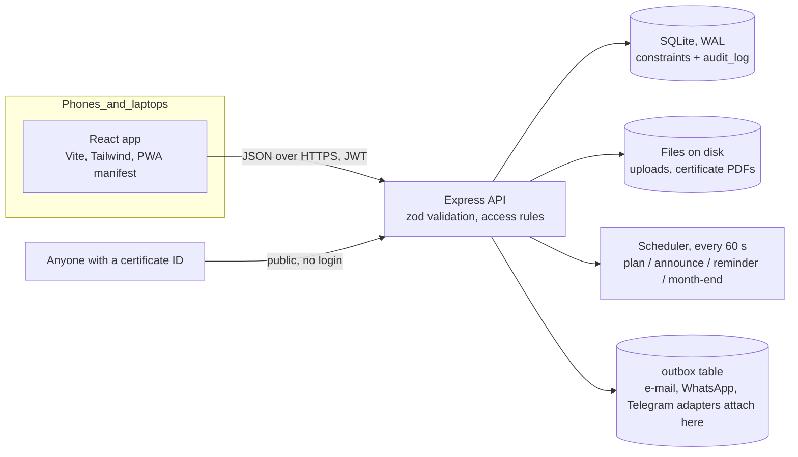

# CampusCred: architecture and design notes

## 1. Shape of the system

One Node process serves the API under `/api/v1` and the built web app. The browser talks only to the API; there is no other backend.

## 2. Data model (apps/api/src/schema.js)

`campuses` > `clubs` > `memberships` (position, status) · `club_days` > `activities` (the plan) > `sessions` (one per activity or event) > `attendance` ·
`submissions` > `evaluations` · `events` > `teams`, `event_regs`, `duty_leaves` · `certificates` (also holds transcripts) · `notifications`, `outbox`, `audit_log`, `budget_requests`, `settings`, `reminders`, `monthly_reports`.

Integrity is enforced by the database, not only by code:

| Rule | Mechanism |
|---|---|
| One President, one VP, one Treasurer per club | partial unique index on `memberships(club_id, position)` where active and a leadership position |
| One check-in per student per session | `UNIQUE(session_id, user_id)` |
| One registration per student per event; one team name per event | `UNIQUE` constraints, plus a transaction around capacity and team-size checks |
| One session per activity / event | partial unique indexes |
| No duplicate certificate for the same achievement | unique index on `(user_id, kind, ref_key)` |

## 3. Check-in design (the integrity-critical path)

* `token = sessionId.slot.HMAC(secret, sessionId.slot)` with `slot = floor(unixSeconds / 20)`; accepted for the current and previous slot. The per-session secret never leaves the server.
* The 6-digit code is `HMAC(secret, "code"+sessionId+slot) mod 10^6`; the server finds it by checking only sessions the student is eligible for.
* The hot path is `POST /checkin`: verify the JWT, 1 user lookup, 1 session lookup, 1 membership lookup, 1 insert. No joins. A per-student rate limit protects it, not a per-IP one, because a campus shares Wi-Fi addresses.
* Corrections go through a separate endpoint that requires a reason and writes `audit_log(actor, old, new, reason)`.

## 4. Certificates and verification

Each certificate gets an ID (`CC-2026-XXXXXXXX`), a **record fingerprint** (SHA-256 over holder, title, club/event, date and ID, stored in the database) and a **file fingerprint** (SHA-256 of the exact PDF bytes, stored when the PDF is generated; the PDF is generated once and stored).
The public page `/verify/:id` re-computes the record fingerprint from the live record (detecting database edits) and shows valid / revoked / not found.
Uploading a PDF compares its bytes to the stored file fingerprint, so changing a single byte fails the check. The QR on the PDF points to the verify page.
Transcripts are issued the same way; downloading again with unchanged data returns the same verified file.

## 5. Permissions

`lib/access.js` is the single source of truth (admin, campus manager of that campus, advisor of that club, coordinator of that club, member). Every route calls it. Tests assert 15 forbidden cross-club and student-edit attempts return 403. The UI only hides buttons for convenience.

## 6. Reports

`lib/stats.js` computes every figure from raw rows: `attendance % = check-ins / (Club Days held x current active members)`, `submission rate = submissions / (deliverable-based Club Days x members)`, average score over published evaluations. A test recomputes these independently for every club and month and compares.

## 7. Scaling path

* **Today:** one process, SQLite WAL, 100 and 300 simultaneous check-ins are comfortably under 1 s p95; 500 simultaneous is under 1 s with a thin margin (0.84 to 0.99 s) on a single shared vCPU (see TEST_REPORT.md).
* **Next step:** run 2+ API processes behind a reverse proxy (tokens are stateless, so any process can verify any QR); move to Postgres (port the data layer from sync to async) when you need multiple servers writing; move PDF generation to a queue if certificate bursts matter.
* The 4-clubs-now / 30-clubs-later requirement needs no code change: campus and club are rows, capacity and limits are settings.

## 8. Decisions worth knowing

* A check-in session that is still open counts as "held" in dashboards, so a live session shows a partial attendance figure until it closes.
* SQLite instead of Postgres/Supabase: chosen so the project runs with one command and is testable end to end here. It is the biggest deviation from the suggested stack.
* JavaScript API with zod validation; TypeScript on the web app.
* Admin-created clubs are "pending" until the campus manager approves, matching the permission table in the brief.
* One session per activity: re-opening check-in re-uses the same session so attendance never splits.
